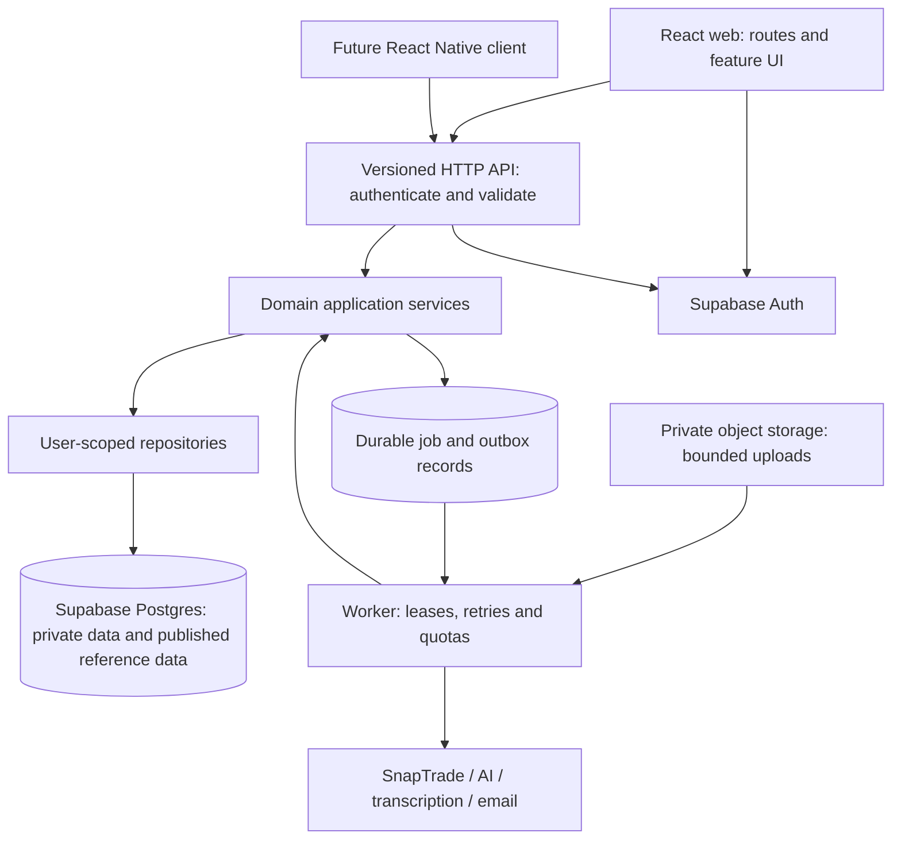

# Proposed application architecture

Status: target architecture, adopted incrementally through the locally verified F1–F4 slices; see [F4 evidence](evidence/F4-identity.md) for implemented boundaries and remaining gates. Future domain/worker/native modules below are not yet built. This is a technical plan, not an amendment to the signed contract. See the milestone PRDs for product acceptance.

## Decision

Build a modular TypeScript application on the existing React/Vite, Vercel, and Supabase direction, with one versioned product API and a separate bounded job runner. Keep one repository and one primary transactional database. Separate responsibilities in code before separating them into services.

The present evidence does not justify a Next.js rewrite, Kubernetes, per-milestone microservices, database sharding, or a separate vector database. React Router already supports nested layouts, dynamic routes, URL parameters, and data loading; the current missing routing is an implementation gap, not a React/Vite limitation. [Official routing documentation](https://reactrouter.com/start/data/routing).

A future rendering/framework change needs a concrete requirement such as public SEO pages or measured server-rendering benefits, a migration cost, and a benchmark. Capacity is established through the tests in `CAPACITY_AND_RELIABILITY.md`.

## Runtime flow



M1 establishes the request boundary, auth, migrations, CI, deployment, telemetry, and the minimum job/adapter conventions. M2 supplies the first real asynchronous workload. Avoid implementing a generic orchestration platform in advance.

## Proposed repository structure

Adopt incrementally; these directories are not present merely because they appear below.

```text
apps/
  web/src/
    app/             router, providers, app shell, error boundaries
    features/        auth, onboarding, portfolios, funds, income, goals, advisor
    components/      small reusable presentation/accessibility primitives
    demo/            explicit demo entry point and fixture adapter
  worker/src/        durable job dispatch, leases, provider adapters
api/                 thin Vercel HTTP entry points
packages/
  contracts/         validated request/response/event shapes; browser safe
  domain/            money, funds, portfolio, forecasts, allocation rules
  server/            use cases, repositories, authorization, provider interfaces
  test-support/      synthetic fixtures, disposable DB and provider harnesses
supabase/
  migrations/        ordered schema changes, grants, RLS and constraints
  tests/             integration/security assertions
tests/
  e2e/               browser acceptance journeys
  load/              reproducible workload scripts and reports
docs/
  rebuild/           PRDs, architecture, backlog and decisions
  reference/         preserved contract and workbook
  runbooks/          operations added when their runtime exists
```

Use npm workspaces and one committed lockfile as the initial package-management direction. The first migration PR must prove clean install, development, build, and deploy from the new root before deleting old paths. Do not combine directory relocation with changes to financial behavior. Add import-boundary lint rules, strict TypeScript, formatting, and dead-code checks once their relevant modules exist.

## Ownership boundaries

| Module | Owns | Does not own |
| --- | --- | --- |
| Identity/onboarding (M1) | authenticated actor, profile, onboarding state, admin authorization | broker access credentials in client code |
| Portfolios (M2) | portfolios, account membership, holdings snapshots, imports, sync state | shared fund metadata or invented target weights |
| Catalogue (M2.5a) | canonical fund/listing identity, versioned attributes, source rows, model portfolios | user holdings or fresh price assertions |
| Distributions (M2.5b) | published distribution events, provider normalization, price/yield definitions | user receipt history treated as fund-level announcements |
| Forecasting (M3) | deterministic versioned formulas, assumptions, milestones | financial arithmetic delegated to AI |
| Goals (M4) | saved goals, constrained proposed allocations, rationale versions | corpus ingestion or autonomous trades |
| Knowledge/advisor (M5) | permitted corpus, chunks, retrieval, citations, answer policy/evaluations | private portfolio access without authorization |
| Engagement (M6) | check-in runs, target-based drift, preferences, notification delivery | order placement |
| Operations (M7) | release gates, support/admin assembly, QA and runbooks | postponing security/testing until launch |
| Mobile (M8) | native experience, secure sessions, push consent, store builds | a second financial engine/database |

Each owning module controls writes. Other modules call its use cases or consume versioned published data/events; they do not reach across arbitrary tables from UI components.

## Routes and web state

Mobile is the primary product and web is a peer client with the same financial behavior. Native delivery is contractually M8, but the API and domain contracts must be usable by mobile from M1. A browser resized to a phone is not acceptance of the React Native milestone. If the 2,500-person beta is a native beta, bring a thin M8 shell and store/test-distribution setup forward after M1; do not wait until web launch to discover native auth/deep-link/API incompatibilities. This changes implementation order, not completion of M8 or contractual milestone labels. See `PRODUCT_EXPERIENCE.md` for parity and readability gates.

Proposed route inventory:

- Public: `/`, `/login`, `/auth/callback`, `/auth/recovery`, `/demo/*`.
- Authenticated: `/app/onboarding`, `/app/home`, `/app/portfolios`, `/app/portfolios/:portfolioId`, `/app/funds`, `/app/funds/compare`, `/app/funds/:fundId`, `/app/calculator`, `/app/goals/:goalId`, `/app/advisor`.
- Admin: `/admin/funds`, `/admin/distributions`, `/admin/content`, later operations pages. The server authorizes every request independently of route guards.
- Explicit 404, permission-denied, session-expired, loading, empty, and stale-data states. Refresh/deep links must preserve identity and route state.

Use React Router data routing and one query-cache library (proposed TanStack Query) for server state. Route loaders may prefetch the same query keys; do not create competing caches. Keep draft form state local, navigable filters in the URL, and persisted preferences/goals on the server. Scope every private cache key to identity/portfolio/version and clear it on sign-out/account change. Never place private API responses in public CDN caches.

Route-lazy-load charts, chat, admin tools, and workbook parsing. Do not put SheetJS in the common app shell. Long browser parsing, if retained for preview, runs in a worker with limits; server validation remains authoritative. Reuse UI tokens/accessibility primitives, not entire 600–900-line components with embedded business logic.

## API and authorization

All product reads/writes use `/api/v1/...` contracts. Supabase Auth SDK calls and narrowly scoped signed object-upload URLs are explicit exceptions. This gives the future mobile app the same behavior as the web app. F4 selects Zod runtime schemas with inferred TypeScript request/response types in `packages/contracts` as the shared source of truth; no independent hand-maintained client types. OpenAPI/client SDK generation can be added when needed; it is not implemented yet.

Every request resolves a verified actor, validates payload/path/query, authorizes the resource, and calls a use case. Do not trust `user_id` supplied in JSON. For ordinary user operations, repositories use the user's verified JWT through Supabase Data API so RLS also applies. Do not default every endpoint to service-role access. Admin/provider jobs use narrowly scoped server-only access and must separately enforce ownership, role, and write constraints.

The application API is a supported-client convention, not a firewall around Supabase: a member can call any Data API surface their token is granted. Therefore API validation/quotas alone cannot protect business invariants. Keep base domain tables in non-exposed schemas with RLS; expose only reviewed read projections and narrowly scoped transactional command RPCs where needed. Prefer security-invoker commands under the verified user context, explicit grants and ownership constraints. Do not grant unrestricted client writes to computed results, publication state, adopted targets, job outcomes or quota counters. Critical field validation, state transitions, idempotency and cost/admission invariants must also hold at the command/database boundary. Test direct Data API calls that bypass the app API, including tampered results and invalid state transitions. Review read surface/query limits and platform rate controls; API-only rate limits do not bound direct Data API reads. F4 must encode this exposure design before private writes ship.

Supabase table grants and RLS are separate controls; configure and test both. Use private schemas for credentials/internal jobs and exposed schemas only where needed. Direct SQL in workers uses a bounded pool and an appropriate pooled connection mode; session-only migrations use their proper connection. The platform offers transaction pooling for transient connections, with mode-specific restrictions to verify against the chosen client. [API security](https://supabase.com/docs/guides/api/securing-your-api), [connection modes](https://supabase.com/docs/guides/database/connecting-to-postgres).

Proposed response conventions: stable error code, safe user message, request ID, validation details where safe, and retryability; paginated collections with a stable cursor and bounded limit; decimal numbers transmitted as strings with units/currency; UTC instants separate from market-local calendar dates; source version and `asOf` timestamps on derived snapshots. Long work returns `202` and an owned job resource. Stable event names and contracts live in `packages/contracts`, not ad hoc strings spread among features.

Financial mutations, import commits, sync requests and AI generation accept an idempotency key scoped to actor/operation. The same key plus a different request digest is a conflict. Store the outcome; publish side effects through an outbox in the same transaction where necessary. Define retention and replay behavior per operation.

## Data model principles

- Canonical fund/listing IDs distinguish exchange/currency/share class; ticker alone is not a global ID. Maintain source aliases and effective dates.
- Separate shared catalogue/distribution/knowledge data from private profile/portfolio/goal/conversation data. Public reference data must not contain raw workbook documents or private user notes.
- Enforce ownership across related records with reviewed constraints and repository checks; `user_id` on every table does not by itself guarantee consistent ownership.
- Store position snapshots atomically with source, effective date, import/sync ID, and revision. A failed sync retains the last good snapshot and marks freshness honestly.
- Preserve raw source rows privately with file hash, sheet/row locator, parser version, validation report and publication version. Publish a validated version atomically; rollback selects a prior valid version.
- Store quantities and money in precise decimal representations. Currency conversion requires explicit rate/source/date. Unknown cost basis, future distributions, and absent target weights remain unknown.
- Estimates expose formula/version/input assumptions. Actual income, projected income, current yield and yield on cost have distinct names and definitions.
- Use optimistic version checks for concurrent edits; add constraints/indexes for real access paths. Avoid N+1 queries, unbounded scans and offset pagination for large changing histories.
- Retention, user deletion, backup restoration and source withdrawal must cover derived records and queued work, not just top-level tables.

No production data migration is authorized by this document. First discover whether real users/data exist, reconcile applied migration history, and test upgrade and repair on a disposable copy. Never reset a live database to fit a new schema.

## Asynchronous work and third parties

Start with a durable Postgres-backed queue/outbox and an independently runnable worker. Select the supported queue implementation and worker hosting through a measured M1/M2 spike; the worker must handle imports/transcriptions longer than an HTTP request deadline. A Vercel endpoint should enqueue work, not pretend that a detached promise is durable execution.

Jobs have an actor/resource, type/version, payload reference, attempt count, lease/heartbeat, deadline, progress, terminal error and idempotency key. Use at-least-once delivery with idempotent handlers; do not promise exactly-once external effects. Bound concurrency per provider and tenant; apply backoff with jitter, dead-letter state, cancellation, and operator replay. Verify callback authenticity and reject replay before enqueuing.

A provider outage should leave saved portfolios and published catalogue data readable. Catalogue/distribution ingestion happens once per publication, not once per user. Portfolio sync occurs on a controlled cadence or explicit request, not every page load. Never create one LLM or broker call for every component render.

## Shared AI boundary and M4/M5 sequencing

M1 defines adapter contracts, secret handling, quota/usage accounting hooks and request/job instrumentation. Implement the actual bounded model invocation when M4 first needs it. M4 uses published catalogue/model-portfolio data plus deterministic validation to propose allocations. M5 adds ingestion, transcription, retrieval and citation policy to the same gateway. Therefore M4 does not depend on unfinished M5 RAG, and M5 does not create a second AI stack.

For either feature: authorized input only, token/time limits, model/prompt version, source snapshot IDs, structured output validation, no invented fund IDs, no automatic trade tools, rate limits and a per-user/global cost limit. A malformed or unavailable model result fails honestly or offers an explicitly non-AI deterministic alternative. Retrieved documents are untrusted context; prompt-injection and cross-user retrieval are release-blocking test cases.

## Engineering decisions and revisit triggers

| Decision | Reason | Revisit when |
| --- | --- | --- |
| React/Vite + real router | Existing UI investment; no demonstrated SSR requirement | Public SEO or measured rendering requirement cannot be satisfied cleanly |
| Modular monolith + worker | Shared financial rules, small operational surface, long jobs isolated | One workload needs independently owned deployment/scaling beyond worker/API separation |
| Single Postgres + pgvector candidate | Existing Supabase direction, transactions and tenant model | Representative retrieval benchmarks or data scale cannot meet SLO after tuning |
| Versioned server API | Web/mobile consistency and controlled provider access | A measured bottleneck warrants a narrowly documented direct-data path |
| npm workspace, one lockfile | Incremental change from current npm setup | Measured build/CI costs justify additional tooling |
| Read-only brokerage access | Contracted sync/visualization; no order placement requirement | A separately scoped trading product is approved |

## Foundation win condition

A new developer can clone, install, run a documented local environment, sign in, complete persisted onboarding, navigate directly to a protected URL, and make an authorized API request. A second user's request is denied by both API and database tests. CI recreates the schema, runs meaningful tests and builds the same artifact deployed to preview. A controlled error is traceable without exposing personal financial data. A deploy can be rolled back without invalidating the schema. M2 may then add portfolio behavior against stable contracts.
