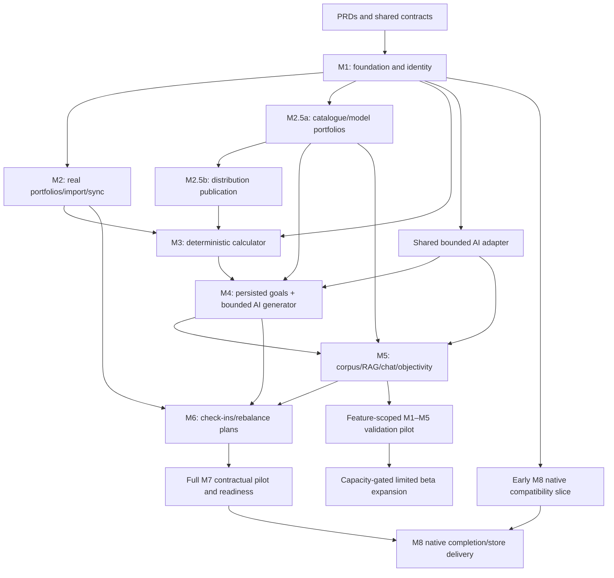

# Rebuild execution plan

Status: implementation plan, not authorization to deploy or a report of completed product work. The planning branch is `codex/foundation-rebuild-plan`, created from `master@4dbf440`. The independent `feat/portfolio-import@f3b65e2` branch is preserved.

Implementation update: the first F1–F3 engineering slice is on `codex/foundation-phase-1`; [evidence and residual gates](evidence/F1-F3-foundation.md) distinguish local completion from hosted CI/deployment and full M1 acceptance. F4's identity backend and actual migration replay/isolation checks are on `codex/foundation-identity`; [F4 evidence](evidence/F4-identity.md) records local results and remaining F5/F6 gates. No remote schema upgrade or product launch is implied.

## What “rebase the codebase” means here

Establish a new architectural baseline through small reviewed changes. Do not rewrite the published history of the old developer's branch. Keep its commit IDs as evidence, selectively port useful pieces, and retain the existing demo while complete user journeys move into the new structure. A Git rebase is unnecessary to achieve this and would complicate recovery of concurrent work.

The current product is mostly a prototype, so there is little functioning backend behavior to preserve. Still, preserve the source documents, useful UI assets/tokens, intended journeys and tests worth improving. Do not spend weeks cosmetically rearranging fixture-driven screens before implementing a real path through authentication, API, persistence and UI.

## Dependency map

Arrows express product integration dependencies, not permission to violate contractual demo/payment gates. Pure M3 arithmetic and permitted-content inventory can be designed earlier; they cannot be called integrated/accepted until their actual inputs and persistence paths pass. M5 can start corpus preparation once M1 ingestion rules and publication identities exist; M4 does not wait for full M5 RAG. Shared AI access is enabling infrastructure, not a separate full milestone.

The user prioritized M1–M5: this is seven signed milestones including M2.5a/b. M6–M8 receive complete plans now to prevent architectural dead ends. Security, testing, readability and mobile compatibility start in M1; they do not wait for M7/M8. An early 10–20-person M1–M5 validation pilot can precede the feature-scoped 2,500-user beta if capacity/support/native readiness pass. It does not establish full M7 acceptance; rerun the pilot on complete launch scope including M6 before full contractual web launch.

## Work allocation and sequencing

Parallelize discovery and bounded work behind stable contracts. Initially one integrator owns identity, contracts, deployment and architectural decisions. A second contributor can prepare source reconciliation/fixtures and another can design the accessible UI without creating competing API/data models. Do not have ten coding agents independently build ten milestones.

After M1's identity/contract/database gates, M2 and catalogue work can proceed in separate branches with explicit shared instrument/ownership contracts. Merge each complete slice promptly after checks, keeping one active owner for shared contracts. Changes to a contract require affected milestone review. AI and native work consume that contract; they do not invent new tables/endpoints independently.

## Ordered pull-request backlog

Each row is a reviewable intent; split it further if the implementation cannot be reviewed and verified coherently. Proposed branch names use `codex/`. Effort/calendar estimates follow the first foundation slices and provider spikes, not before them.

| Slice | Change | Must precede | Win condition |
| --- | --- | --- | --- |
| F0 | Preserve source inventory; add AGENTS, project README, milestone PRDs, shared architecture and workload | Product implementation | Every signed deliverable has an owner and acceptance ID; conflicts/open decisions documented |
| F1 | Establish supported Node version, npm workspace/one lockfile, strict TypeScript and import boundaries; move app with minimal behavior change | Broad feature migration | Fresh install/build/dev works from root; deploy config matches; no financial changes mixed into relocation |
| F2 | Required CI checks and useful baseline tests; root contributor/runbook commands | Feature migration | Deliberate failure blocks promotion; migration replay and test-data isolation run in CI |
| F3 | Real route tree, accessible shell/error states, query-state conventions and demo isolation | All live screens | Deep link/refresh/history/404 work; private shell cannot render fixtures |
| F4 | Verified API identity, profile/onboarding schema, trusted admin role, two-user RLS/API tests | M2 and admin | Allowed operations succeed; cross-user/forged-role access fails with unchanged state |
| F5 | Email + Google lifecycle, persisted onboarding, safe cache clearing and session recovery | Live beta access | Both sign-in methods, interruption/resumption/logout/account switch pass E2E |
| F6 | North American staging, Sentry/redaction, deployment/rollback smoke, safe readiness | M1 acceptance | Tagged error traced; reproducible preview; rollback rehearsed; M1 signed acceptance evidence assembled |
| N1 | Thin native compatibility spike after F4/F5; API client, sign-in/deep-link, one readable screen | Mobile-first beta expansion | Same test user/profile state works on web/iOS/Android development builds; record native decisions before porting UI |
| P1 | Correct money/currency/value semantics; persisted manual portfolio/account/holding path | Imports/sync | Save, refresh and cross-device read agree; unknown values remain unknown; CAD/USD golden tests pass |
| P2 | Bounded upload staging, worker lease/idempotency path, import mapping/validation/diff/commit | CSV acceptance | Real file produces reviewed persisted snapshot; retry/crash does not duplicate or partially publish |
| P3 | Provider capability spike, read-only SnapTrade connect/sync/reconnect/disconnect and callback verification | Full M2 acceptance | Named brokers and 20+ capability matrix verified; last good snapshot survives provider failure |
| P4 | Multiple-portfolio UI and interactive allocation against real snapshots | Full M2 acceptance | Create/switch/reload portfolios; scoped counts and money agree across API/UI; all M2 acceptance IDs pass |
| C1 | Stable fund/listing identity and source dictionary agreed with P1 | C2, D1 and AI selection | Ticker collisions, management fee vs MER and model constituents resolved without invented facts |
| C2 | Workbook Tab 4/model importer + source reconciliation and publication | M2.5a screens | >=140 validated distinct ETFs; every required source row/model accounted for or explicitly unresolved |
| C3 | Basic admin CRUD, screener/deep links/three-way comparison/real videos | M2.5a acceptance | Admin and user journeys work against published data; no four-fund or fixture leakage |
| D1 | Canonical distribution schema and validated sponsor upload adapters | D2 | Preview explains additions/changes/errors; duplicate upload safe; publication atomic |
| D2 | Yield definitions/price provenance, history/charts/dates and admin diff flow | M2.5b acceptance | 12–24-month model with honest gaps; sourced values and dates; all required admin operations tested |
| K1 | Versioned deterministic calculator library and independent examples | K2 and M4 | Agreed tax/inflation/compounding/milestone semantics pass boundary tests |
| K2 | Readable calculator UX, sourced optional inputs and persisted tracking | M3 acceptance | Server and local previews agree; missing assumptions and unattainable goals explicit |
| A1 | Real bounded AI adapter, quota/usage accounting, output schema and failure policy | M4 generation | Real smoke response validated; timeout/invalid output/limit cases behave honestly |
| G1 | Persist goals/questionnaire/revisions and shared projection integration | G2 | Save/reopen on web and native-compatible API, with exact assumption/version lineage |
| G2 | Constrained AI allocations/rationale and explicit adoption | M4 acceptance | Invalid funds/weights rejected; no invented math; saved rationale reproducible from recorded inputs |
| P5, alongside G2 | M2-owned applied target revision/adoption extension | M4 adoption and M6 drift | Explicit owned confirmation, optimistic version/idempotency and direct database command invariants pass M2-A10; M4 records only a reference |
| R1 | Approved content inventory, transcription/chunking/embedding jobs and source permissions | R2 | Content can be traced/reprocessed/withdrawn; job retries preserve version integrity |
| R2 | Permission-filtered retrieval/chat/questionnaire/citations/objectivity | R3 | Unsupported answers abstain; prompt injection and cross-user retrieval tests pass |
| R3 | Full two-week prompt-tuning sprint and measured evaluation gates | M5 acceptance | Versioned evaluation results and reviewer approvals demonstrate all signed M5 outcomes |
| L1 | Shared integration/load/usability gate through M5 | Beta expansion | M1–M5 IDs have evidence; 1,000-session beta workload, restore and failure drills pass |

“ASAP” should shorten feedback loops and unnecessary scope, not omit contract features. Keep richer catalogue coverage, advanced offline writes, autonomous portfolio changes, gamification/social, and new infrastructure out unless explicitly required. The signed two-week M5 tuning period remains a real duration constraint; early corpus/evaluation preparation prevents it becoming avoidable idle time.

## Salvage, replace, and retire

| Existing area | Treatment | Reason/evidence |
| --- | --- | --- |
| CSS tokens, reusable visual assets, chart presentation | Salvage after readable-text/a11y review | Useful visual work; current 9–11px labels cannot be carried over indiscriminately |
| Feature route/auth skeleton | Port selectively with failure/return-path tests | Real routes exist there, but email and persisted authenticated onboarding are absent |
| Mapping/parser tests | Retain valuable fixtures, correct assumptions and expand cases | 33 passing tests prove narrow functions, not upload integration; parsing conflates cost/currency semantics |
| `derive.js` | Rewrite financial behavior against agreed examples | Mixed-currency sum, invented targets, current value used for yield on cost, missing/future-date cases |
| Supabase migration | Review as input, reconcile applied history before new migrations | RLS/grants groundwork useful; tenant graph constraints and domain separation incomplete |
| 922-line Plan / 668-line Portfolio / 576-line Discover | Replace progressively with feature slices | Rendering, state, math, fixture responses and actions are coupled |
| `dummy.js` | Retain only as clearly named synthetic/demo fixtures | Production must never import it or substitute it on live errors |
| Dead legacy views | Remove after route/import audit and replacement tests | Duplicate flows increase confusion; deletion must not erase intended behavior accidentally |
| Fake order queue and canned AI claims | Remove/label while live journeys are introduced | Present UI claims capabilities that do not exist |
| Existing proposal-derived plans | Mark historical, link to signed PRDs | Google-only/single-portfolio exceptions and M3/M5 numbering conflict with contract |

## Migration and rollback rules

Before schema work, discover whether the hosted environment has real users/data and capture its migration state without exposing secrets. Test an additive upgrade on disposable data. If there are no users, a clean schema can still be built in a separate environment; do not assume that permits resetting existing remote projects.

Use explicit route/feature switches for replacement, with one writer per domain. Avoid silent dual-write migration. Snapshot/compare representative outputs; if a formula intentionally changes, update its version and expected examples rather than calling the old output correct.

Keep APIs compatible across rolling web and store-distributed mobile releases. Database changes use expand/migrate/contract across releases; a code rollback should not require destructive schema rollback. Record publication versions and last-good portfolio snapshots so ingestion rollback is possible without deleting user history.

## Evidence gate for every slice

A slice is done when its actual user behavior and failure path are demonstrated, the relevant domain/integration/browser tests pass, the docs and contracts agree, sensitive data are isolated, and the change has a recovery path. “Files generated,” “looks good,” “build passed,” and “agent says complete” are not acceptance evidence.

Track each result as requirement ID, acceptance ID, commit, environment, command/manual scenario, expected/observed outcome, evidence path and reviewer. Do not mark the PRD accepted simply because planning is complete. Client milestone approval remains distinct from internal engineering verification.

## Decisions to settle at their implementation boundary

| Decision | Needed by | Proposed default / blocking evidence |
| --- | --- | --- |
| Native beta vs responsive-web beta date | N1 and beta scheduling | Treat mobile as primary; prepare native compatibility early; exact distribution date remains unconfirmed |
| Email method | F5 | Verified email/password with recovery; adapt if client wants passwordless; test usability and delivery |
| Existing production users/migration history | F4 | Discover read-only before database changes |
| Worker host/queue runtime | P2 | Bounded independently runnable worker; choose through representative import/transcription spike and cost review |
| Market price/distribution freshness source | D1/D2 | Admin-validated uploads satisfy the named input workflow; current yield needs an approved dated price source |
| Tax method and portfolio assumptions | K1 | Client-reviewed educational effective-drag model; do not label generic country percentages as accurate tax advice |
| Broker regional/provider capabilities | P3 | Verify client-enabled integrations and credentials; fallback CSV does not fulfill an absent named integration |
| AI provider/model and per-user usage budget | A1 | Benchmark structured outputs/latency/cost with fixed evaluation cases; no paid vendor commitment in this plan |
| Intended initial 10k and future active-user definition | Before expansion load campaign | Beta is already specified: 2,500 users / 1,000 online; model larger cohorts separately |

These uncertainties do not block the repository, test, route and identity groundwork. Provider acceptance, production provisioning and reliable cost forecasts depend on resolving their specific prerequisites.
